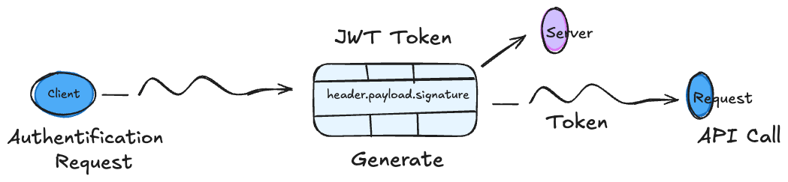

# JWT Auth — REST API in Go with JWT Authentication

A minimal REST API in Go demonstrating JWT (JSON Web Token) authentication with PostgreSQL.



## Features

- User registration (`POST /auth/register`)
- Login and JWT token generation (`POST /auth/login`)
- Protected route: authenticated user profile (`GET /users/me`)
- Bearer Token authentication middleware
- Password hashing with `bcrypt`

## Tech Stack

| Component | Technology |
|---|---|
| Language | Go 1.26 |
| Database | PostgreSQL |
| SQL Driver | `github.com/lib/pq` |
| JWT | `github.com/golang-jwt/jwt/v5` |
| Password Hash | `golang.org/x/crypto/bcrypt` |

## Project Structure

```
jwt/
├── cmd/
│   ├── main.go          # Entry point
│   └── api/
│       └── api.go       # HTTP server, routing, dependency injection
├── db/
│   └── db.go            # PostgreSQL connection
├── internal/
│   ├── auth/
│   │   ├── handler.go      # Register / Login handlers
│   │   ├── service.go      # Auth business logic
│   │   └── jwt_manager.go  # Token generation and verification
│   ├── middleware/
│   │   └── auth_middleware.go # Bearer Token verification
│   ├── user/
│   │   ├── model.go        # User struct
│   │   ├── repository.go   # SQL queries
│   │   ├── service.go      # User business logic
│   │   ├── handler.go      # /users/me handler
│   │   └── errors.go       # Domain errors
│   └── pkg/ctxkeys/
│       └── keys.go         # HTTP context keys
└── go.mod
```

## Prerequisites

- Go 1.22+
- PostgreSQL

## Installation

```bash
git clone <repo-url>
cd jwt
go mod download
```

## Database Setup

Create the database and users table:

```sql
CREATE DATABASE user_db;

\c user_db

CREATE TABLE users (
    id            BIGSERIAL PRIMARY KEY,
    full_name     TEXT      NOT NULL,
    email         TEXT      UNIQUE NOT NULL,
    password_hash TEXT      NOT NULL
);
```

Update the DSN in `cmd/main.go` if needed:

```go
dsn := "postgres://<user>:<password>@localhost/user_db?sslmode=disable"
```

## Running

```bash
go run ./cmd/main.go
# Server start on :8383
```

## Endpoints

### `POST /auth/register`

Creates a new user.

**Request body:**
```json
{
  "full_name": "John Doe",
  "email": "john@example.com",
  "password": "mypassword"
}
```

**Response `201 Created`:**
```json
{
  "id": 1,
  "full_name": "John Doe",
  "email": "john@example.com"
}
```

---

### `POST /auth/login`

Authenticates a user and returns a JWT token (valid for 20 minutes).

**Request body:**
```json
{
  "email": "john@example.com",
  "password": "mypassword"
}
```

**Response `200 OK`:**
```json
{
  "data": {
    "id": 1,
    "full_name": "John Doe",
    "email": "john@example.com"
  },
  "token": "eyJhbGciOiJIUzI1NiIsInR5cCI6IkpXVCJ9..."
}
```

---

### `GET /users/me`  *(protected)*

Returns the profile of the authenticated user.

**Required header:**
```
Authorization: Bearer <token>
```

**Response `200 OK`:**
```json
{
  "id": 1,
  "full_name": "John Doe",
  "email": "john@example.com"
}
```

## Security

- Tokens are signed with HMAC-SHA256.
- Token expiry is set to 20 minutes.
- The password is never returned in responses (tagged `json:"-"`).
- Replace the JWT secret and DSN with environment variables before deploying to production.
